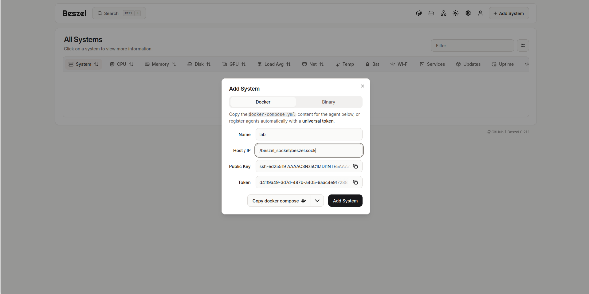
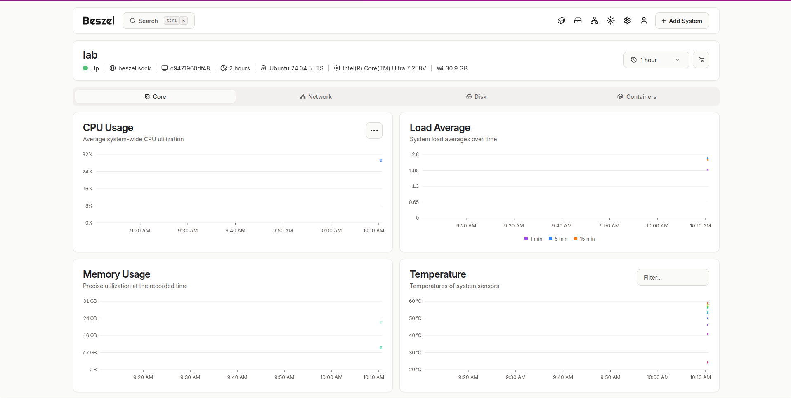
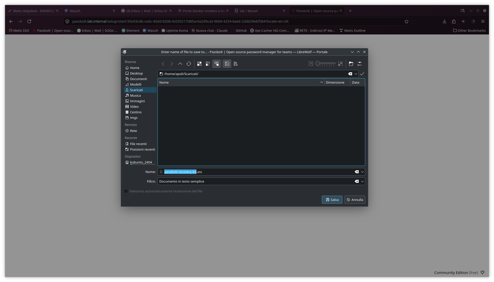
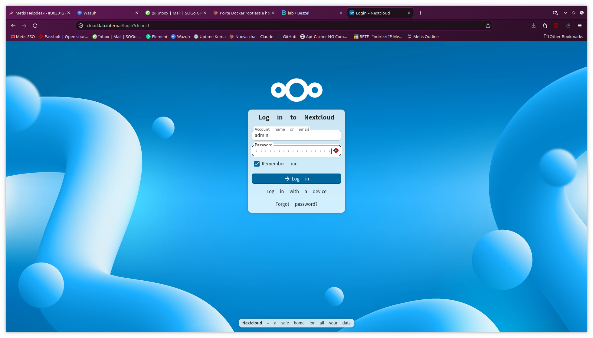
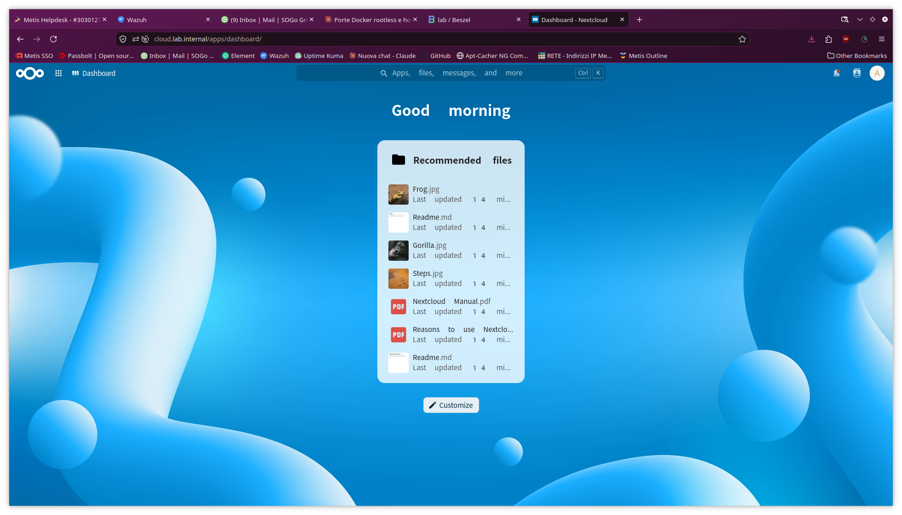
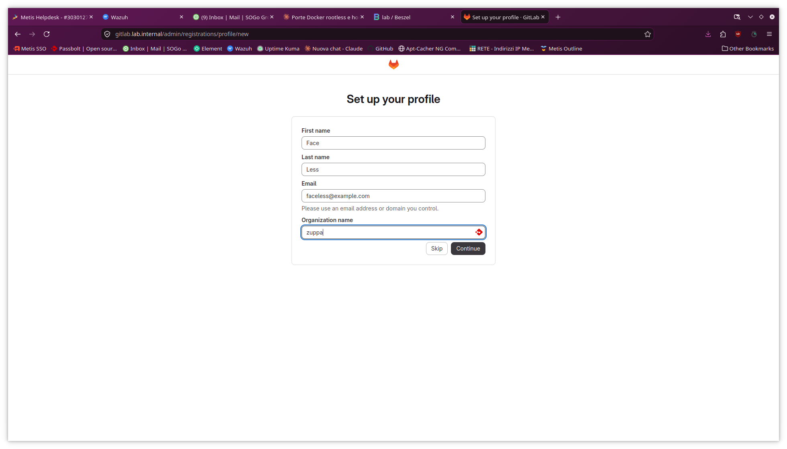

# HomeLab

Laboratorio self-hosted con password manager, cloud, GitLab, DNS, strumenti PDF e monitoraggio. Tutti i servizi stanno dietro un unico reverse proxy (Caddy) e si raggiungono da un tunnel VPN NetBird.

> Le misure di sicurezza perimetrali non sono gestite da questo laboratorio: nel progetto sono affidate a un'altra macchina che funge da reverse proxy.

## Documentazione

| Documento | Per chi | Contenuto |
|---|---|---|
| [server-side.md](./script/server-side/server-side.md) | chi installa il laboratorio sull'host | requisiti, file `.env`, avvio con e senza VPN, server NetBird, configurazione dei servizi |
| [client-side.md](./script/client-side/client-side.md) | chi deve accedere al laboratorio | installazione delle CA, client NetBird, verifica dell'accesso, SSH di GitLab |

## Come funziona

Nessuna porta del laboratorio è pubblicata sull'host. L'ingresso è Caddy (con `caddy-l4` per l'SSH di GitLab), che termina l'HTTPS con una CA interna. I client entrano da un peer NetBird che instrada verso Caddy e Pi-hole; Pi-hole risolve il dominio interno verso Caddy.

Gli indirizzi qui sotto usano il dominio predefinito `lab.internal`, modificabile con la variabile `LAB_DOMAIN`.

## Servizi

| Servizio | Indirizzo | Container |
|---|---|---|
| Beszel (monitoraggio) | `monitor.lab.internal` | Zeus, Aquila (agent) |
| Passbolt (password manager) | `passbolt.lab.internal` | Ade |
| Nextcloud (cloud) | `cloud.lab.internal` | Demetra |
| GitLab (forge Git) | `gitlab.lab.internal`, SSH su `git-ssh.lab.internal` | Efesto |
| Pi-hole (DNS) | `pihole.lab.internal` | Apollo |
| Stirling-PDF (strumenti PDF) | `pdf.lab.internal` | Dedalo |
| Caddy (reverse proxy) | — | Ermes |

## 📊🎛️ [Beszel (pannello di controllo)](https://www.beszel.dev/)

Monitoraggio leggero dell'host e dei container: CPU, memoria, disco, rete e stato di ogni servizio, in un'unica dashboard. È composto da un hub web e da un agent che legge le metriche dal demone Docker.

Configurazione: [server-side.md → Beszel](./script/server-side/server-side.md#beszel)

## 🔐 [Passbolt](https://www.passbolt.com/)

Password manager open source pensato per i team, basato su OpenPGP: le credenziali si condividono tra utenti e gruppi restando cifrate end-to-end.

Configurazione e creazione degli utenti: [server-side.md → Passbolt](./script/server-side/server-side.md#passbolt)

## ☁️ [Nextcloud](https://nextcloud.com/)

Cloud personale per file, calendari e contatti, con sincronizzazione da desktop e mobile (WebDAV, CalDAV e CardDAV).

Configurazione e primo accesso: [server-side.md → Nextcloud](./script/server-side/server-side.md#nextcloud)

## 🦊 [GitLab](https://about.gitlab.com/)

Gestione di repository Git, issue e pipeline CI/CD. L'accesso via SSH passa da Caddy sulla porta 22, con un nome dedicato (`git-ssh.lab.internal`).

Configurazione e primo accesso: [server-side.md → GitLab](./script/server-side/server-side.md#gitlab) · Uso dell'SSH: [client-side.md](./script/client-side/client-side.md#usare-gitlab-via-ssh)

## 🌐 [Pi-hole (DNS)](https://pi-hole.net/)

Resolver DNS locale con interfaccia web. Risolve tutto il dominio interno verso Caddy e inoltra il resto ai resolver pubblici, con il blocco di pubblicità e tracker.

Configurazione e record locali: [server-side.md → Pi-hole](./script/server-side/server-side.md#pi-hole)

## 📄 [Stirling-PDF](https://www.stirlingpdf.com/)

Strumenti per i PDF in locale: unire, dividere, convertire, comprimere, firmare, OCR. I file non lasciano il laboratorio. L'interfaccia è in italiano e le lingue OCR aggiuntive si installano nel volume `stirling_tessdata`.