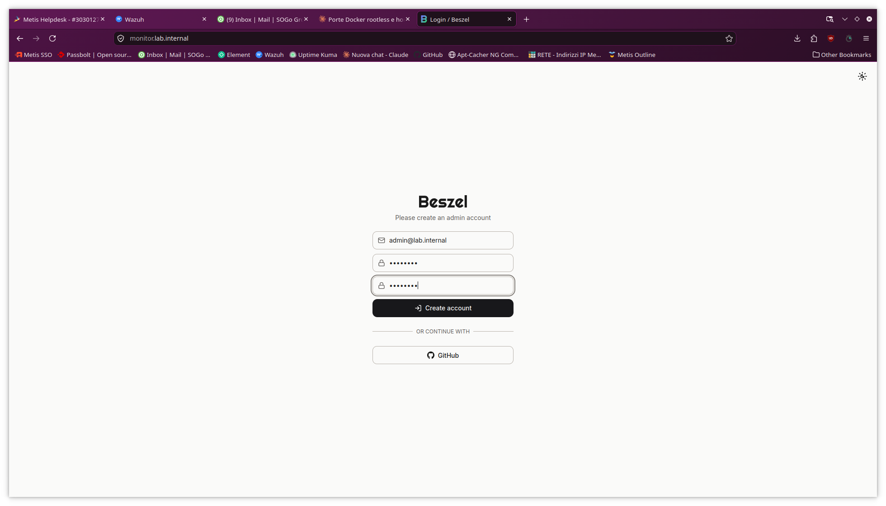
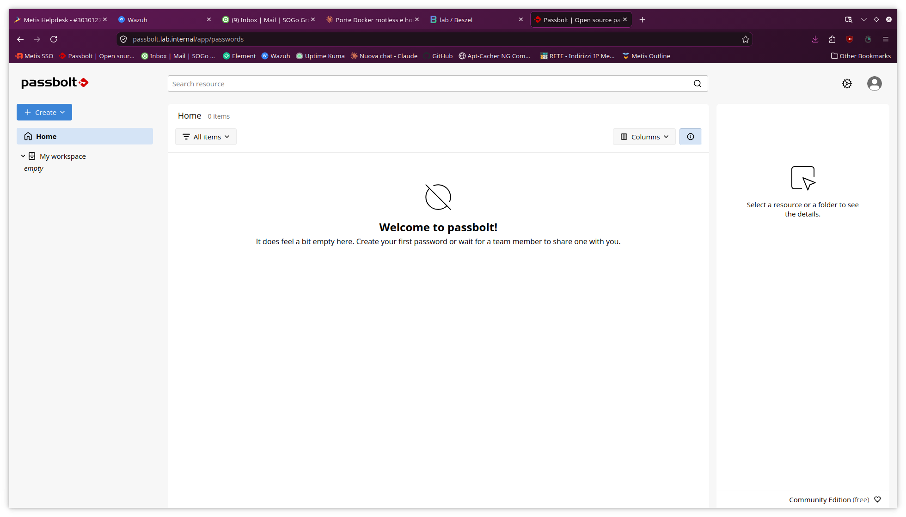
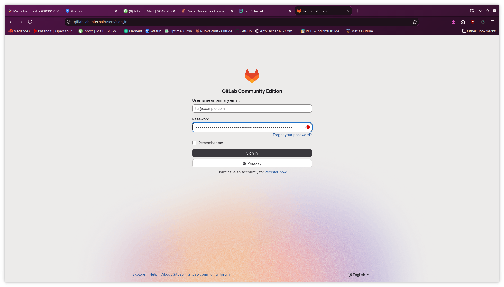
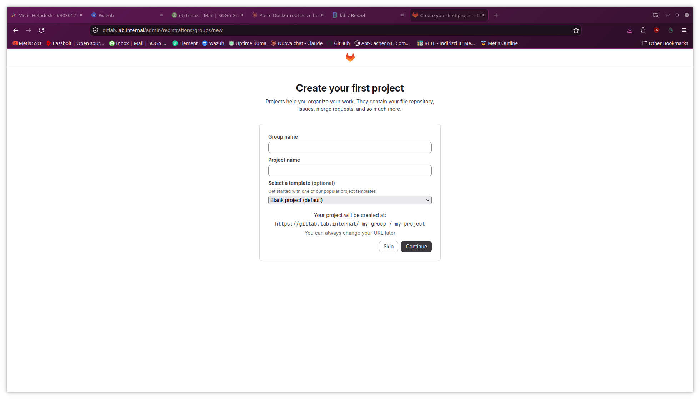

# HomeLab

Questo homelab non gestisce anche le misure di sicurezza che per come è gestito il progetto vengono gestite su un'altra macchina che funge da reverse proxy

## 🚨 REQUISITI MINIMI DI HARDWARE 🚨

- **RAM**: 8 GB 

## Setup

Prima di tutto servono le chiavi e i token per tutti i servizi.

```bash
chmod +x script/env.sh
./script/env.sh
```

Alcune chiavi/tocken andranno configurati più avanti, nel mentre modifica la mail e la password associate all'account admin di gitlab: [GITLAB_ROOT_EMAIL](./script/lab/.env#)  e [GITLAB_ROOT_PASSWORD](./script/lab/.env#L7)

Ci sono due modi per avviare questo laboratorio, con o senza VPN.

Il container netbird sta sulla stessa rete Docker di Caddy (homelab_net), quindi lo raggiunge direttamente all’IP 172.30.10.3, senza passare dall’host. Il traffico dei client entra nel 
tunnel, che il peer apre in uscita verso il server NetBird: non gli arrivano connessioni in ingresso, quindi non serve nessun ports: su peer.yml. Se il collegamento diretto tra i due peer 
non riesce (probabile con il NAT di slirp4netns), il traffico passa dal relay del server NetBird, sempre senza porte aperte sul peer.

### SENZA VPN

Dato che docker rootless non permette di aprire porte sotto la 1024 ci si presentano due soluzioni: utilizzare docker rootfull oppure usare sudo per abbassare il limite delle porte apribili
da docker e continuare a beneficiare dei benefici di sicurezza di rootless.

Si controlla il limite attuale con: **sudo sysctl net.ipv4.ip_unprivileged_port_start**

E si abbassa con: **sudo sysctl -w net.ipv4.ip_unprivileged_port_start=22**

Queste modifiche non sono permanenti, al prossimo riavvio saranno ripristinate.
Per renderle permanenti basteranno i seguenti tre comandi.

```bash
echo 'net.ipv4.ip_unprivileged_port_start=22' | sudo tee /etc/sysctl.d/99-rootless-ports.conf
sudo sysctl --system
```

Ora si aggiungono i domini dei servizi al /etc/hosts: **echo '127.0.0.1  passbolt.lab.internal gitlab.lab.internal cloud.lab.internal pihole.lab.internal monitor.lab.internal git-ssh.lab.internal pdf.lab.internal' | sudo tee -a /etc/hosts**.


e si controlla che le modifiche siano state applicate (**sudo sed -i '/lab\.internal/d' /etc/hosts**)

```bash
# avvio del laboratorio
docker compose -f script/lab/homelab.yml -f script/lab/homelab.local.yml
# estrazione del certificato root
docker compose -f script/lab/homelab.yml -f script/lab/homelab.local.yml cp caddy:/data/caddy/pki/authorities/local/root.crt script/lab/caddy-lab-root.crt
```

### CON VPN

```bash
docker compose --env-file script/.env -f script/netbird/netbird.yml up -d
#docker compose -f homelab.yml -f homelab.local.yml up -d 
```

```bash
echo "NB_PEER_IP=$(docker compose --env-file script/.env -f script/homelab.yml exec -T netbird sh -c "ip -4 -o addr show wt0 | awk '{print \$4}' | cut -d/ -f1")" >> script/.env
```


```bash
docker compose --env-file script/.env -f script/homelab.yml up -d
```

```bash
curl -fsSL https://pkgs.netbird.io/install.sh | sh
netbird up --management-url https://netbird.home.arpa:8443 --setup-key
```

## 📊🎛️ [Beszel (pannello di controllo)](https://www.beszel.dev/)




```bash
docker compose -f script/lab/homelab.yml up -d beszel-agent
```

## 🔐 [Passbolt](https://www.passbolt.com/)

La pagina di passbolt ci chiederà il login o di resettare la passphrase di un utente già esistente quindi per creare un nuovo utente va eseguito questo comando.

```bash
docker compose -f script/lab/homelab.yml exec passbolt su -m -c "/usr/share/php/passbolt/bin/cake \
  passbolt register_user \
  -u <tuaemail@example.com> \
  -f <Nome> \
  -l <Cognome> \
  -r admin" -s /bin/sh www-data
```
Restituirà un link da copiare e incollare su browser , basterà seguire la procedura di creazione dell'account e sarete apposto.




## ☁️ [NextCloud](https://nextcloud.com/)

Al primo avvio viene creato l'utente `admin` (l'installazione richiede 1-2 minuti).
La password è [NEXTCLOUD_ADMIN_PASSWORD](./script/lab/.env#L8) nel file `.env`.


## 🦊 [GitLab](https://about.gitlab.com/) 

Al primo avvio (alcuni minuti) viene creato l'utente **root**, con email e password che  avremo precedentemente configurato nel file [.env](./script/env.sh)
[GITLAB_ROOT_EMAIL](./script/lab/.env#L6) /  del .






## 🌐 [Pi-hole (DNS)](https://pi-hole.net/)

Resolver DNS locale con interfaccia web. La password è [PIHOLE_PASSWORD](./script/lab/.env#L9) nel file [.env](./script/env.sh).
I record locali si aggiungono da Settings → Local DNS → DNS Records.
Test: `dig @127.0.0.1 example.com` (se la porta 53 è occupata, vedi la mappatura 5353).


