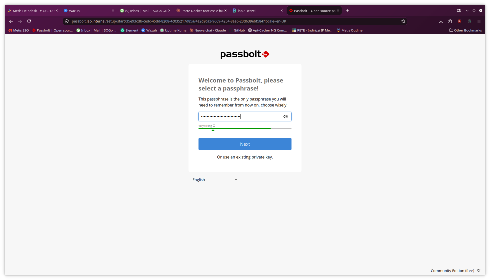
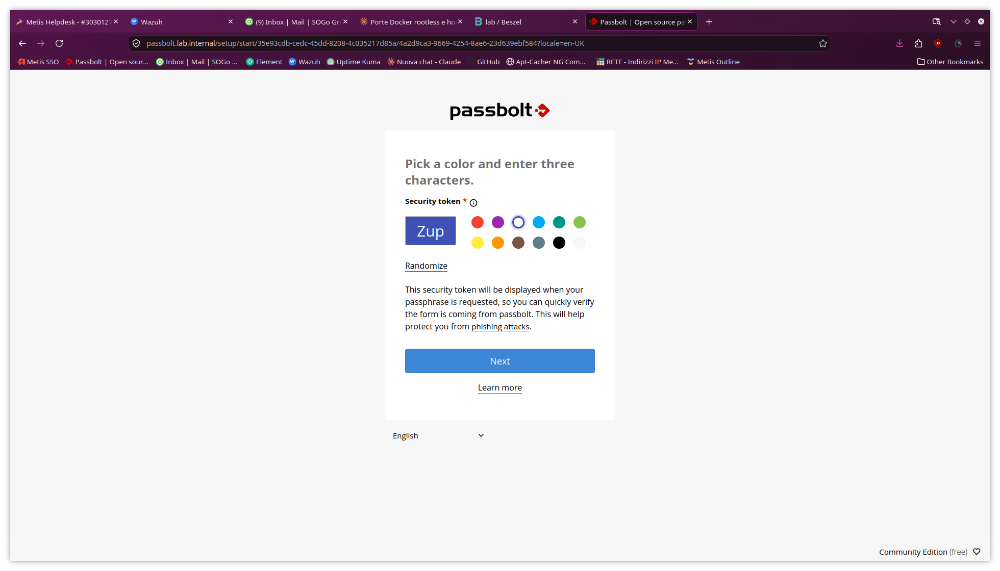

# HomeLab

Questo homelab non gestisce anche le misure di sicurezza che per come è gestito il progetto vengono gestite su un'altra macchina che funge da reverse proxy

## 🚨 REQUISITI HARDWARE 🚨

| Risorsa | Minimo | Consigliato |
|---|---|---|
| RAM | 8 GB | 16 GB |
| CPU | 4 vCPU | 6–8 vCPU |
| Disco | 40 GB liberi | 100 GB (SSD) |

**Software**
- Docker Engine in modalità rootless
- Docker Compose 2.23.1 o successivo
- cgroup v2 con i controller `cpu`, `memory`, `io` e `pids` delegati
- Dispositivo `/dev/net/tun` (per il peer NetBird)

**Rete**
- Porte `8443/tcp` e `3478/udp` aperte sull'host per il server NetBird
- Il nome `netbird.home.arpa` risolvibile dai client

> Con 8 GB di RAM il laboratorio funziona, ma i servizi più pesanti (GitLab, Nextcloud, Stirling-PDF) possono essere riavviati per mancanza di memoria se sono sotto carico contemporaneamente.

## Setup

### 1. Scarica il repository

```bash
git clone https://github.com/PoliAlb/HomeLab.git
cd HomeLab/
```

I comandi seguenti partono da questa cartella.

### 2. Verifica i prerequisiti

```bash
docker info --format '{{.SecurityOptions}}'   # deve contenere name=rootless
docker compose version                        # 2.23.1 o successiva
stat -fc %T /sys/fs/cgroup                    # deve stampare cgroup2fs
ls /dev/net/tun                               # necessario per NetBird
echo "$XDG_RUNTIME_DIR/docker.sock"           # socket del demone rootless
```

### 3. Genera il file `.env`

```bash
chmod +x env.sh
./env.sh
```

Lo script richiede `openssl` e non sovrascrive un `.env` esistente. Crea password e chiavi casuali (permessi `600`): **non** versionare il file.

Modifica subito una sola riga:

| Variabile | Cosa fare |
|---|---|
| `GITLAB_ROOT_EMAIL` | sostituisci `tu@example.com` con la tua email |

Le password generate (`GITLAB_ROOT_PASSWORD`, `NEXTCLOUD_ADMIN_PASSWORD`, `PIHOLE_PASSWORD`, ...) si leggono nel `.env`:

```bash
grep -E 'PASSWORD' .env
```

Queste variabili restano vuote e si compilano più avanti:

| Variabile | Quando |
|---|---|
| `NB_SETUP_KEY` | dopo aver avviato il server NetBird (solo con VPN) |
| `BESZEL_KEY`, `BESZEL_TOKEN` | dopo il primo avvio di Beszel |

### Senza VPN

Il lab è raggiungibile solo dalla macchina che ospita Docker, tramite porte pubblicate su `127.0.0.1`.

**1. Consenti a Docker rootless di usare la 443**

Docker rootless non può pubblicare porte sotto la 1024. Controlla il limite e abbassalo:

```bash
sysctl net.ipv4.ip_unprivileged_port_start
sudo sysctl -w net.ipv4.ip_unprivileged_port_start=443
```

Il valore vale per **tutti** gli utenti dell'host e dopo il riavvio torna a `1024`. Per renderlo permanente:

```bash
echo 'net.ipv4.ip_unprivileged_port_start=443' | sudo tee /etc/sysctl.d/99-rootless-ports.conf
sudo sysctl --system
```

In alternativa puoi evitare il `sysctl` usando la porta `8444` al posto della `443`, ma i link e i redirect di GitLab, Nextcloud e Passbolt puntano alla 443 e funzionano solo con un redirect locale.

**3. Aggiungi i nomi dei servizi a `/etc/hosts`**

```bash
echo '127.0.0.1 passbolt.lab.internal gitlab.lab.internal cloud.lab.internal pihole.lab.internal monitor.lab.internal git-ssh.lab.internal pdf.lab.internal' | sudo tee -a /etc/hosts
```

Controlla che la riga ci sia:

```bash
grep lab.internal /etc/hosts
```

Per **rimuovere** le voci in un secondo momento: `sudo sed -i '/lab\.internal/d' /etc/hosts`.

**4. Avvia il lab**

```bash
docker compose -f homelab.yml -f homelab.local.yml up -d --build
docker compose -f homelab.yml ps
```

GitLab diventa `healthy` dopo circa 5 minuti.

**5. Estrai il certificato e installalo nel browser**

```bash
docker compose -f homelab.yml cp caddy:/data/caddy/pki/authorities/local/root.crt ./caddy-lab-root.crt
```

Importa `caddy-lab-root.crt` tra le autorità di certificazione attendibili del browser o del sistema, altrimenti compare l'avviso sul certificato.

### Con VPN

Il lab non pubblica nessuna porta: i client entrano da un tunnel NetBird. L'ordine dei passi conta, perché ogni progetto crea una rete o un volume usati dal successivo.

**1. Prepara la rete**

- I client devono risolvere `netbird.home.arpa` verso l'IP LAN dell'host (record sul router o in `/etc/hosts`).
- Sul router inoltra `8443/tcp` e `3478/udp` verso l'host.
- Sull'host aprile nel firewall:

```bash
sudo ufw allow 8443/tcp
sudo ufw allow 3478/udp
```

**2. Avvia il server NetBird**

```bash
docker compose --env-file .env -f script/netbird/netbird.yml up -d
```

Crea la rete `nbnet` e il volume `nb_caddy_data`. Estrai la sua CA e installala nei client e nel browser:

```bash
docker compose --env-file .env -f script/netbird/netbird.yml cp caddy:/data/caddy/pki/authorities/local/root.crt ./netbird-ca.crt
```

**3. Crea l'amministratore e la setup key**

Apri `https://netbird.home.arpa:8443`, crea l'utente admin e una **setup key** (assegnale il gruppo `lab-gw`). Scrivila nel `.env`:

```
NB_SETUP_KEY=la-tua-chiave
```

**4. Avvia il lab** (crea la rete `homelab_net`)

```bash
docker compose -f script/lab/homelab.yml up -d --build
docker compose -f script/lab/homelab.yml exec dns dig +short @127.0.0.1 gitlab.lab.internal   # atteso: 172.30.10.3
```

**5. Avvia il peer**

```bash
docker compose --env-file .env -f script/netbird/peer.yml up -d
docker compose --env-file .env -f script/netbird/peer.yml exec netbird netbird status   # Management: Connected
```

**6. Configura la dashboard NetBird**

I nomi delle voci possono variare con la versione.

1. **Groups:** `lab-gw` (il peer `homelab-gw`) e `lab-users` (i tuoi client).
2. **Networks:** crea una rete `homelab` con routing peer `homelab-gw` e masquerade attivo. Aggiungi come risorse `172.30.10.3/32` (Caddy) e `172.30.10.53/32` (Pi-hole).
3. **Access control:** una policy da `lab-users` verso le risorse della rete.
4. **DNS → Nameservers:** `172.30.10.53` con dominio `lab.internal`, assegnato a `lab-users`.

**7. Collega un client**

Installa NetBird seguendo le istruzioni ufficiali (se usi lo script `curl | sh`, leggilo prima di eseguirlo), poi:

```bash
netbird up --management-url https://netbird.home.arpa:8443
```

Si apre il browser per l'accesso. Per un client senza interfaccia grafica aggiungi `--setup-key LA_TUA_CHIAVE`. Estrai e installa anche la CA di Caddy del lab:

```bash
docker compose -f homelab.yml cp caddy:/data/caddy/pki/authorities/local/root.crt ./caddy-lab-root.crt
```

**8. Verifica dal client**

```bash
nslookup gitlab.lab.internal           # atteso: 172.30.10.3
curl -I https://gitlab.lab.internal
```

## 📊🎛️ [Beszel (pannello di controllo)](https://www.beszel.dev/)


```bash
docker compose -f script/lab/homelab.yml up -d beszel-agent
```

## 🔐 [Passbolt](https://www.passbolt.com/)

La pagina di passbolt ci chiederà il login o di resettare la passphrase di un utente già esistente quindi per creare un nuovo utente va eseguito questo comando.

```bash
docker compose -f script/lab/homelab.yml exec passbolt su -m -c "/usr/share/php/passbolt/bin/cake \
  passbolt register_user \
  -u <tuaemail@example.com> \
  -f <Nome> \
  -l <Cognome> \
  -r admin" -s /bin/sh www-data
```
Restituirà un link da copiare e incollare su browser , basterà seguire la procedura di creazione dell'account e sarete apposto.







## ☁️ [NextCloud](https://nextcloud.com/)

Al primo avvio viene creato l'utente `admin` (l'installazione richiede 1-2 minuti).
La password è [NEXTCLOUD_ADMIN_PASSWORD](./script/lab/.env#L8) nel file `.env`.


## 🦊 [GitLab](https://about.gitlab.com/) 

Al primo avvio (alcuni minuti) viene creato l'utente **root**, con email e password che  avremo precedentemente configurato nel file [.env](./script/env.sh)
[GITLAB_ROOT_EMAIL](./script/lab/.env#L6) /  del .


## 🌐 [Pi-hole (DNS)](https://pi-hole.net/)

Resolver DNS locale con interfaccia web. La password è [PIHOLE_PASSWORD](./script/lab/.env#L9) nel file [.env](./script/env.sh).
I record locali si aggiungono da Settings → Local DNS → DNS Records.
Test: `dig @127.0.0.1 example.com` (se la porta 53 è occupata, vedi la mappatura 5353).


